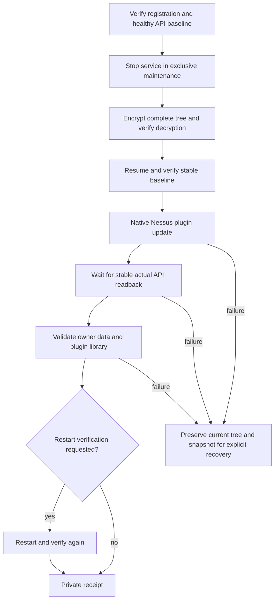

# Operation model

The standard installation root is fixed to `/opt/nessus`; runtime state is fixed to `/var/lib/nessus-safe-install`. Arbitrary restore targets and cross-installation restores are not exposed. A single Linux flock serializes this tool's operations. It does not lock other administrators, native automatic updates or unrelated tools: exclusivity must be reserved operationally.

HTTPS transport is pinned to `127.0.0.1:8834`, with the supplied hostname retained for TLS certificate verification and HTTP Host. This prevents taking a local filesystem backup based on an unrelated remote scanner's API. Custom ports and proxy-only API access are not supported in this release.

## Data and integrity

The encrypted snapshot contains the full stopped tree, including plugins, databases, users, keys, certificates, settings and scan data. It is a local filesystem recovery mechanism for the **same installation and binary**, not the vendor's portable configuration-backup format. External mounts and symbolic-link installation roots are refused. Archives containing unsupported devices, absolute/escaping links, duplicate normalized paths or descendants of links are refused before extraction.

GPG AES-256 encrypts the tar stream directly. A SHA-256 of the plaintext stream is compared against actual decryption. Ciphertext and plaintext digests are verified again before recovery. The manifest is private; the passphrase is never stored. Snapshots are not cleaned up automatically.

Rollback extracts into a new sibling directory on the installation filesystem. No current file is overwritten. `renameat2(RENAME_NOREPLACE)` first preserves the old tree and then promotes the restore. If the second rename fails before promotion, the exact old inode is restored. If a result is uncertain after a filesystem acknowledgement failure, both trees remain available for operator inspection; there is no blind destructive retry. This is a two-step swap, not a power-loss-proof atomic exchange. Keep independent backups and inspect a stopped host after an interrupted swap.

## Credential handling

Interactive use prompts for the username and uses a hidden password/passphrase prompt. Non-interactive callers can supply `--auth-fd` containing a small JSON object with `username` and `password`, and a different `--passphrase-fd` containing the snapshot passphrase. Supply both from an approved secret manager through pipes, close the producer end to signal EOF and invoke the tool in an already-privileged execution context. `sudo` commonly closes extra descriptors; descriptor preservation depends on your own approved policy.

Do not use activation codes, passwords or private feed URLs in command-line arguments, environment files, repository files or issue reports. Sessions stay in process memory and are logged out on completion. The API uses certificate and hostname verification and never follows redirects. Native registration output is classified in memory and represented by a digest and safe flags. Raw updater output is suppressed.

## Native process boundaries

The tool does not rewrite feed metadata, change marker permissions, patch executables, reset registration, set a custom feed or transplant compiled caches. Native `nessuscli update` owns those transitions. A healthy authenticated baseline is mandatory; an existing empty/broken installation requires diagnosis before it can become an update baseline.

Update subprocesses run in a separate session. SIGINT/SIGTERM are deferred while a native command is running, and the native process inherits the operation lock. The wrapper waits for a real exit rather than killing an updater on a timer. SIGKILL, power loss and vendor descendants closing inherited descriptors still require operator recovery; this is not a full transaction coordinator.

Readiness deadlines bound API waiting, not the native updater. A stable 60-second API window is required after baseline resume and after update. An immediate deferred reload resets that window. This observation cannot guarantee that an unrelated later job will not modify the installation. The receipt distinguishes a changed plugin set from a same-set update.

## Acceptance boundaries

- An installation receipt proves package-manager success and service start; registration is a separate step.
- A registration check establishes native eligibility at that time; it does not prove delivery of a new update.
- Update acceptance requires actual plugin counts, matching installed/loaded set, unchanged account identities and scan/policy metadata.
- Any plugin/family count decrease requires review, including legitimate vendor removals.
- Administrator-visible scan status is checked. Other users' private jobs/schedules need operational exclusion.
- No target scan is created, so detection quality, target connectivity and scan performance remain untested.
